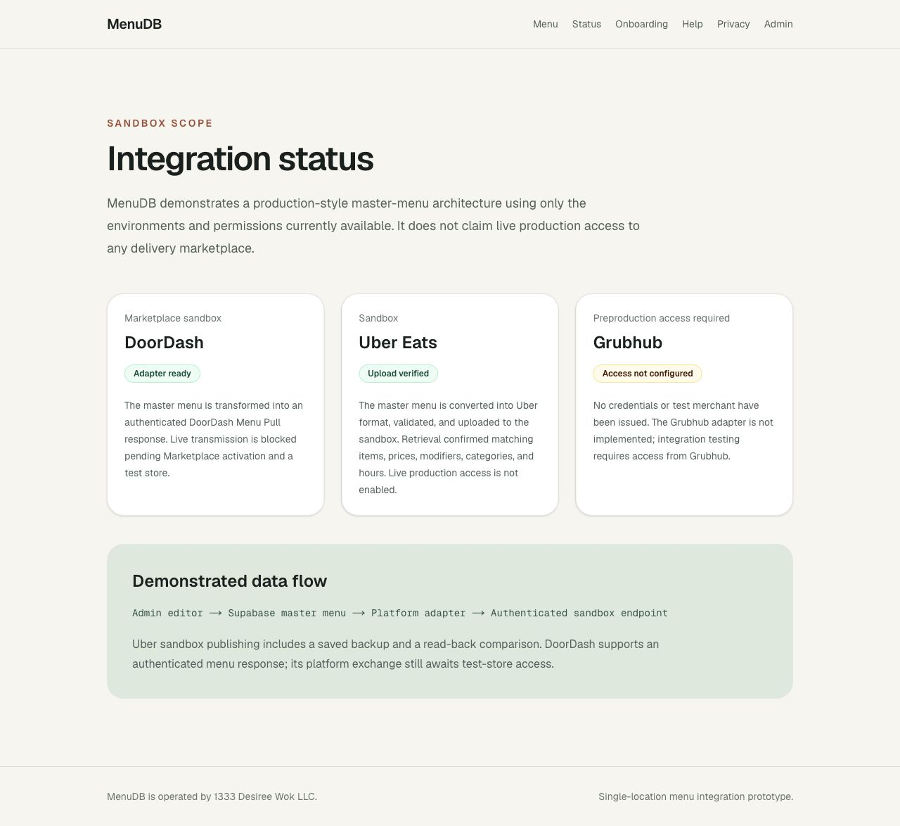
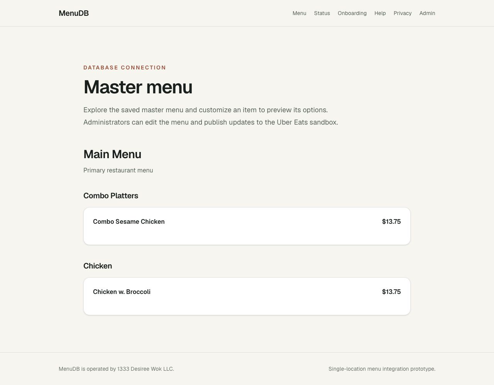
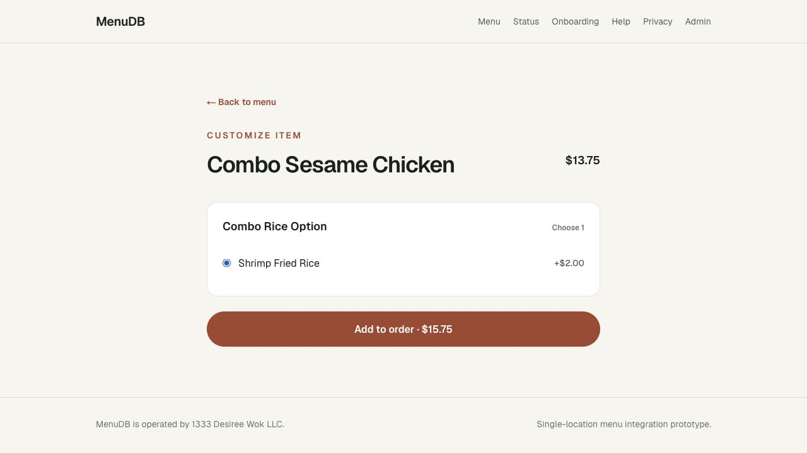
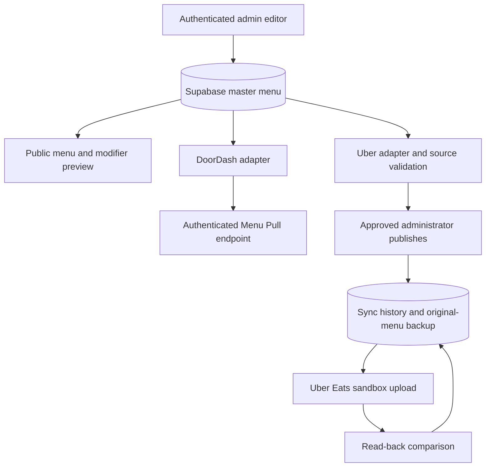

# MenuDB portfolio demonstration

## Two-minute walkthrough

1. Open `/menu`. Explain that categories, prices, and item options come from one Supabase master menu.
2. Open an item and select its modifiers. Demonstrate a required choice and an added price. This is a customization preview, not checkout.
3. Sign in at `/admin` using your own account. Change an item price and save. Refresh `/menu` to show the same change.
4. In the publishing panel, expand **Review saved menu and hours**. Show the menu counts and Tuesday–Saturday hours.
5. Confirm replacement of the sandbox menu and click **Publish to Uber sandbox**. Show the pending state, verified result, last-published time, and history entry.
6. Open `/status`. Explain that Uber has a verified sandbox exchange, DoorDash has a tested adapter awaiting test-store access, and Grubhub access is not configured.

Use only synthetic test data in a public recording. Keep sign-in, passwords, environment files, browser autofill, and platform dashboards containing credentials out of frame.

## Suggested screenshots

Captured from the deployed application:

- Public menu with categories and prices.
- Item customization with modifier choices.
- Admin publishing panel after a verified attempt, including its history.
- Integration status page showing the different evidence levels honestly.

Screenshots should capture actual results. The history table starts empty; earlier CLI uploads are not backfilled as new dashboard events.

## Resume wording

Built a Next.js and TypeScript menu-management application with Supabase authentication and row-level security; implemented platform menu adapters and verified Uber Eats sandbox publishing with backups, read-back validation, and persistent sync history.

The database migration and local dashboard publish were tested successfully on November 4, 2026. Hosted publishing requires the same environment settings and a signed-in test on Vercel. Do not claim production marketplace access or automatic three-platform synchronization.

## Architecture

